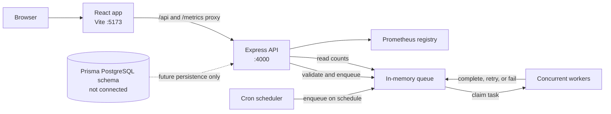

# Queuehouse

Queuehouse is a small task-queue system you can run on a laptop. It has a React operations screen, an Express API, and a set of Node workers. It is meant for exploring queue behavior and the frontend/backend boundary; it is not backed by a durable database or broker yet.

## Get it running

You need Node.js 20 or newer and npm. From this folder, run:

```powershell
npm install
npm run dev
```

Open the frontend at [http://127.0.0.1:5173](http://127.0.0.1:5173). The API listens at [http://127.0.0.1:4000](http://127.0.0.1:4000). The API starts the in-memory queue, demo tasks, cron scheduler, and worker loops together.

Useful checks:

```powershell
npm test
npm run build
npm run db:validate
```

`db:validate` checks the Prisma schema and needs `DATABASE_URL` to be set. Copy `backend/.env.example` to `backend/.env` first, then adjust the URL if needed. This validation reads the configuration but does not open a database connection.

## How the pieces fit

The browser only talks to the frontend origin. During development, Vite forwards `/api` and `/metrics` requests to the API. The workers and scheduler live in the API process and use the same in-memory queue as the HTTP routes.



### A task's trip through the system

1. The dashboard sends `POST /api/tasks` with a task name and JSON object payload.
2. The API validates the request. The queue returns an existing task if its idempotency key has already been used; otherwise it stores the new task in memory.
3. A worker claims an eligible waiting task. Higher priority tasks are claimed first; tasks at the same priority are handled oldest first.
4. The demo processor simulates work. Success marks the task completed. Failure schedules a retry with exponential delay until `maxAttempts` is reached, after which the task enters the dead-letter state (`failed`).
5. The dashboard polls the API for task and overview data and reflects the updated state.

Pausing the queue prevents workers from claiming new tasks. Work already claimed is allowed to finish.

## Folder layout

The repository root holds the workspace scripts, lockfile, and shared documentation. Application code lives in its workspace:

```text
backend/
	prisma/                 Future PostgreSQL schema
	src/
		http/routes/           API routes grouped by responsibility
		metrics/               Prometheus setup
		schedules/              Cron schedule manager
		tasks/                  Queue, task types, seed data, and queue tests
		workers/                Task processing loops
frontend/
	src/
		components/             Shared dashboard and task UI
		features/               Task, schedule, and metrics workflows
		lib/                    API client and formatting helpers
```

The old top-level `src/`, `prisma/`, and generated `dist/` folders have been removed. Keep new runtime code inside the workspace that owns it.

## API at a glance

| Method | Path | Purpose |
| --- | --- | --- |
| `GET` | `/api/health` | API status, storage mode, and worker settings |
| `GET` | `/api/overview` | Counts, pause state, workers, processing time, recent tasks, schedule count |
| `GET` | `/api/tasks` | List tasks; optionally filter with `?status=waiting`, `active`, `completed`, `failed`, or `delayed` |
| `POST` | `/api/tasks` | Validate and enqueue a task |
| `POST` | `/api/tasks/:id/retry` | Return a dead-letter task to the queue |
| `POST` | `/api/queue/pause` | Stop workers from claiming new tasks |
| `POST` | `/api/queue/resume` | Allow workers to claim tasks again |
| `GET` | `/api/schedules` | List recurring jobs |
| `POST` | `/api/schedules` | Register a cron expression and task payload |
| `DELETE` | `/api/schedules/:id` | Stop and remove a recurring job |
| `GET` | `/metrics` | Prometheus metrics, including queue counts and enqueue total |

Example enqueue body:

```json
{
	"name": "email.send",
	"payload": { "recipient": "ops@example.com" },
	"priority": 2,
	"maxAttempts": 3,
	"idempotencyKey": "weekly-digest-2026-11-11"
}
```

To see a task reach the dead-letter list, set `payload.forceFailure` to `true` and `maxAttempts` to `1`. The demo worker recognizes that flag and fails the task on purpose.

## Project guides

- [Backend guide](backend/README.md): API routes, queue rules, workers, schedules, metrics, and configuration.
- [Frontend guide](frontend/README.md): dashboard structure, API communication, user actions, and local development.

## What is and is not persistent

Tasks and schedules are held in process memory. They disappear when the API restarts and are not shared between API instances. `backend/prisma/schema.prisma` describes a possible PostgreSQL model, but the running app does not load Prisma or connect to PostgreSQL. Redis is not used either.

The local API has no authentication and binds to `127.0.0.1`. Before exposing this beyond local development, add authentication and authorization, use durable storage or a broker, make worker claims safe across processes, and persist schedule registration.
