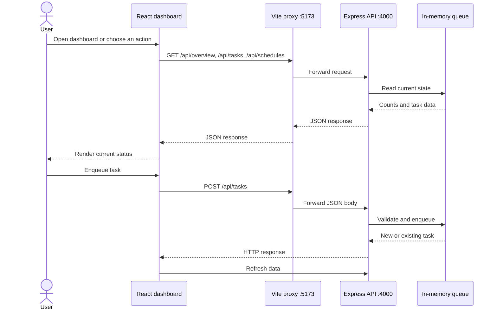

# Frontend

The frontend is Queuehouse's operations screen. It is a React and TypeScript app built with Vite. It shows queue activity and sends user actions to the backend HTTP API; it does not read or change queue state directly.

## Start and build

Run these commands from the repository root:

```powershell
npm run dev:frontend
npm run build --workspace frontend
```

The dev server binds to `127.0.0.1:5173`. To run both sides together, use `npm run dev` from the root and open [http://127.0.0.1:5173](http://127.0.0.1:5173).

There is no frontend-specific test script yet. The production build runs TypeScript checking followed by Vite bundling.

## How it talks to the backend

In development, `vite.config.ts` proxies `/api` and `/metrics` to `http://127.0.0.1:4000`. The app uses relative paths such as `/api/overview`, so it works through that same frontend origin. The shared API helper sends JSON requests and turns non-success responses into errors for the forms and status messages to display.

When the app opens, it requests the overview, task list, and schedules. It repeats those requests every 2.5 seconds and refreshes the list when the selected status filter changes. The UI therefore reflects the in-memory API state, not a local browser database.



## What the screen does

`src/main.tsx` mounts the React app and imports the dashboard styles. `src/App.tsx` owns the page layout and coordinates API-backed state; individual UI pieces live alongside the feature they belong to.

- `src/components/dashboard/MetricCard.tsx`: reusable queue metric card.
- `src/components/tasks/`: task status badge and status glyph.
- `src/components/dialogs/InfoDialog.tsx`: shared information dialog.
- `src/features/tasks/dialogs/`: add-task, task-details, and CSV dialogs.
- `src/features/schedules/ScheduleManager.tsx`: schedule list and creation form.
- `src/features/metrics/MetricsDialog.tsx`: Prometheus output view.
- `src/lib/`: shared API client and date/task-name formatting helpers.
- `src/types.ts`: types shared across frontend features.
- `src/styles.css`, `src/schedule.css`, and `src/interactions.css`: global dashboard, schedule, and interaction styles.

- The sidebar switches between Overview, All tasks, Dead letter, and Schedules. Selected sections and task filters have visible active states.
- The overview cards show waiting, active, completed, and failed counts. Selecting a card filters the task list.
- Search filters the task list already loaded in the browser by name, ID, and payload text.
- Add task checks that the payload is a JSON object, then sends `POST /api/tasks`. It generates an idempotency key for the request. The API supplies the default priority and retry count when they are not sent.
- Task details show status, attempts, priority, payload, result, and any error. Failed tasks can be retried through `POST /api/tasks/:id/retry`.
- Pause and Resume call the queue control endpoints. Pausing affects future worker claims; it does not cancel active tasks.
- Schedules can be listed, added, and deleted through `/api/schedules` routes. The API validates the cron expression and payload.
- Metrics opens the text from `/metrics`. Worker settings and system diagnostics read `/api/health`.
- Export creates a CSV from the currently filtered task list. The dialog offers a preview, clipboard copy, and a download link.
- Profile and workspace menus are local demo presentation only. There is no account service, sign-in flow, or workspace API behind those labels.

Keep page-level navigation and API orchestration in `App.tsx`; put a new workflow under `src/features/<feature>/` and reusable UI under `src/components/`. Keep API requests on the existing relative paths so they continue to pass through the Vite proxy in development.

## Changing the API target

The local proxy target is set in `vite.config.ts` to `http://127.0.0.1:4000`. The backend's default CORS origin is also `http://127.0.0.1:5173`. If either local port or origin changes, update the matching proxy or backend configuration as well.
